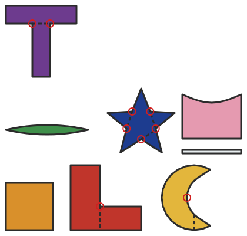

# Grozer

**Checks a stained-glass design for pieces that can't be cut, and finds the fewest extra lead lines that fix them. Glass is cut by scoring and snapping, and the break runs on through the sheet, so an inside corner can't be cut, a deep inside curve can't be nibbled out, and sharp points and slivers snap. Grozer reads each piece's outline, finds the trouble, and searches for the smallest set of lead lines that splits every problem piece into parts you can actually cut.**

Language: TypeScript 5.7 on Node 22 (no runtime dependencies) · Field: stained glass / computational geometry · Day: 6 November 2026

Stained-glass designers learn the rules the hard way: a pattern that looks lovely on paper turns out to have an L-shaped piece, a crescent moon, or a star, none of which can be cut in one piece. Design software helps you draw and print patterns, and some flags lines that don't quite meet, but none tells you *which pieces can't be cut* or *where to add lead to fix them*. Grozer does:

- **The cutter's rules as geometry:**
  - **Inside corners:** a vertex where the outline turns inwards more than 15°.
  - **Inside curves:** each stretch of outline between two corners of the piece's convex hull is a curve. It's too deep if it's more than 0.3 times as deep as it is wide.
  - **Sharp points:** under 30°.
  - **Slivers:** narrower than 10 mm, measured with the hull-edge method.
- **Fewest lines, then least lead:** it searches with iterative deepening and branch and bound:
  - it only branches on lines through the first problem, which still finds the true minimum for corners;
  - candidate lines are straight on from each edge, the angle's bisector, and chords to every vertex in view.
- **Lines that leave cuttable parts:** a lead line is rejected if it would create a sliver or a point sharp enough to snap.
- **A drawing:** `--svg` draws the panel in its glass colours, with the suggested lead lines dashed and the trouble spots ringed.



## Quick start

```bash
npm ci
npm run build
node dist/src/cli.js examples/sampler.txt
node dist/src/cli.js --svg examples/sampler.txt > sampler.svg
npm test        # 14 test groups, including plans re-checked on random pieces
npm run lint    # strict TypeScript, no emit
```

```
GROZER  Cutting sampler
8 pieces. Can't be cut: inside corners turning more than 15°, inside curves deeper than 0.3 of their width. May snap: points under 30°, parts under 10 mm wide.

  OK      square   (amber, 4 sides)
  SPLIT   ell      (red, 6 sides): an inside corner at (180, 60) turns 90°, too sharp to cut.
          Add 1 lead line (40 mm):
            (180, 60) to (180, 20), 40 mm
  SPLIT   moon     (gold, 28 sides): an inside curve near (328, 75) is 41.5 % as deep as it is wide, too deep to nibble out.
          Add 1 lead line (25.9 mm):
            (340.6, 45.9) to (340, 20), 25.9 mm
  OK      leaf     (green, 24 sides)
          Note: the 23.6° point at (160, 190) may snap off.
          Note: the 23.6° point at (20, 190) may snap off.
  SPLIT   star     (cobalt, 10 sides): 5 inside corners too sharp to cut, at (234.7, 221), (225.3, 192), (250, 174), (274.7, 192), (265.3, 221).
          Add 3 lead lines (90.9 mm):
  ...
In all: 4 cut as drawn, 4 need lead lines (6 lines, 186.8 mm of extra lead), 0 can't be fixed automatically.
```

Some things the search works out for itself:
- **The L:** it takes the 40 mm line straight down from the corner, not the 70 mm one across.
- **The T:** one line joins both of its corners.
- **The star:** it needs three lines, since one line can fix at most two of its five corners.

Exit code: 0 if every piece can be cut as drawn, 1 if any needs lead lines, 2 for a bad file.

## The design file

```
window Cutting sampler       # optional name
min-width 10                 # mm; narrower parts may break (default 10)
min-angle 30                 # degrees; sharper points may snap (default 30)
sharp-corner 15              # degrees an inside corner may turn before it can't be cut (default 15)
max-curve 0.3                # how deep an inside curve may be, as a fraction of its width (default 0.3)

piece ell red                # a name and a glass colour
  130,20 250,20 250,60 180,60
  180,130 130,130            # x,y points in mm, on as many lines as you like
```

- **Colours:** clear, opal, white, amber, gold, yellow, orange, red, ruby, pink, purple, violet, blue, cobalt, sky, green, emerald, brown, grey and black.
- **Curves:** draw them as several points; an arc every 10–20° is plenty.
- **Outlines:** they can go either way round.

## Security

The design file is the only input, and Grozer treats it as untrusted:

- **Bounded:** files over 64 KB are refused, with reading stopped at the limit. Lines are limited to 200 characters, pieces to 200, points per piece to 80, and coordinates to 5000 mm with at most two decimals. The search has a fixed budget (60,000 shapes per piece, at most 8 lines), so a hostile outline can't make it run for ever: it reports "too complex" instead.
- **Strict shapes:**
  - every line must be one of seven fixed forms, and every number must match a plain decimal pattern (no `1e9`, `NaN` or negatives);
  - names are lower-case letters, digits and hyphens, and colours come from a fixed list (checked with `Object.hasOwn`, so `__proto__` and `constructor` are refused);
  - outlines that cross themselves or have no area are rejected;
  - invalid UTF-8, control characters and invisible formatting characters (zero-width and bidirectional overrides) are refused.
- **No echoing:** errors give the line number and what was expected, never the text or the file's path.
- **Files only:** the file is opened with `O_NOFOLLOW`, then checked to be a regular file, so links, folders and devices are refused.
- **Safe drawing:** the SVG contains only numbers Grozer computed, colours from its own table, and names passed through an XML escaper. There are no scripts.
- **Tested:** strict TypeScript (`noUncheckedIndexedAccess`, `exactOptionalPropertyTypes`), malicious-input tests, a random-input test of the parser and report, and `npm audit` (no runtime dependencies at all).
- **Known limits:** the rules are a skilled cutter's rules of thumb, not physics. A ring saw can cut what a hand cutter can't, and the settings let you loosen them.

## Files

| File | What it does |
|---|---|
| `src/geometry.ts` | Areas, turns, simple-polygon test, convex hull, width, ray casting |
| `src/parse.ts` | Reads and checks the design file |
| `src/check.ts` | Problems and warnings for a piece; the search for lead lines |
| `src/report.ts` | The text report and the SVG drawing |
| `src/cli.ts` | The command line and safe file reading |
| `tests/grozer.test.ts` | Geometry, problems, fixes re-applied on random pieces, hostile input, the command line |
| `examples/sampler.txt` | Eight pieces, each with a different cutting problem |

See [HOW-IT-WORKS.md](HOW-IT-WORKS.md) for the geometry, the search and interview questions.
