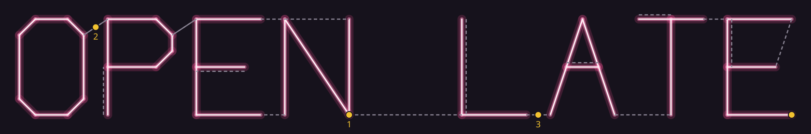

# Tubewise

**Plans the glass for a neon sign: one continuous tube through every letter, with the least blacked-out glass, cut into tubes a bender can handle.**

Language: Perl 5.38 (core modules only) · Field: neon sign making / graph theory (route inspection) · Day: 6 November 2026 (evening)

A neon tube is one piece of glass with an electrode at each end, and it lights all the way along. So a neon bender has to find a route that traces every stroke of every letter, and wherever the route has to go without lighting (back up a stroke, or across to the next letter) the glass is painted black. Benders work this out by hand on the pattern. More black glass means more bending, more painting and more ways to break a tube. More tubes mean more electrodes, more joins to hide, and more failure points.

Tubewise works it out exactly, as the graph problem it is:

- **Strokes to a graph:** a single-stroke capital font (A–Z, 0–9, `-`, `!`, `.`) or your own shape. Strokes are split wherever they cross or touch, so the X, the A's crossbar and the R's leg join where they should.
- **Joining the letters:** separate pieces are linked with the shortest jumpers (a minimum spanning tree). A jumper may not cross or run along lit glass, because a painted tube in front of a lit letter shows.
- **Least black glass:**
  - a continuous route through every stroke once needs at most two odd-degree points (Euler);
  - the odd points are paired with the cheapest black connections, by **minimum-weight perfect matching**: either doubling back along a stroke, or a straight jumper (which costs its length plus its bends);
  - the matching is exact (dynamic programming over subsets) for up to 14 odd points, and greedy with 2-opt swaps above that, and the output says which it used.
- **One route, then tubes:**
  - Hierholzer's algorithm traces the route;
  - it's cut into tubes no longer than your maximum, with the cuts made inside black glass so the electrodes and joints hide;
  - when a lit stroke is simply longer than a tube, the joint has to show, and the plan says so.
- **For the bench:** the route tube by tube, with coordinates, and an SVG drawing showing glowing lit glass, black glass dashed, and electrodes numbered by tube.

## Quick start

```bash
./bin/tubewise "OPEN"                              # plan for 200 mm letters
./bin/tubewise --height 300 --max-tube 1500 "BAR"
./bin/tubewise --svg "OPEN LATE" > sign.svg        # a drawing
./bin/tubewise --design examples/heart.txt         # your own shape
prove -l t                                         # 7 groups, 415 checks
```

```
TUBEWISE  "OPEN"  (letters 200 mm tall)
Lit glass: 2,323 mm, in 4 separate pieces of lettering.

Plan: 2 tubes, 4 electrodes, every joint hidden in black glass.
  Black glass: 540 mm (200 mm doubling back along strokes, 340 mm in 6 jumpers), plus 120 mm for the jumpers' bends.
  Glass to bend: 2,984 mm, in tubes of at most 2,000 mm.
  Bent as separate pieces, it would take 4 tubes and 8 electrodes.
  The blackout is the least possible for these strokes (exact matching of the odd points).

Tube 1 (1,949 mm): electrode at (550, 200)
  light 'N'                     200 mm  to (550, 0)
  black jumper                   50 mm  to (500, 0)
  light 'E'                     333 mm  to (467, 100)
  black, back along 'E'         100 mm  to (367, 100)
  ...
```



Exit code: 0 for a plan, 2 for bad input.

## Your own shape

```
name Heart
stroke 200,40 330,170 345,215 ...     # x,y in millimetres, y up; 2 to 50 points
stroke 20,90 380,250                  # strokes may cross: they're split where they meet
```

Use `--design FILE`, or `--design -` to read standard input.

## Security

Text and design files are treated as untrusted:

- **Text:** it may hold only the font's characters, up to 24 of them. Control and invisible formatting characters (bidirectional overrides, zero-width) are refused.
- **Design files:**
  - files are limited to 64 KB, read in one bounded `read`, with lines of up to 300 characters;
  - at most 400 strokes of 2 to 50 points, coordinates up to 5,000 mm with at most two decimals (no `1e9`, no negatives);
  - names use a small character set, and the file must be valid UTF-8.
- **Bounded work:** the exact matching runs only up to 16 points (65,536 subsets), and above that the heuristic is polynomial. A full 24-character sign plans in under a second.
- **Safe reading:** the script runs in Perl's taint mode with fatal warnings. Design files must be regular files, not links or folders, and errors never echo the input or the path.
- **Safe drawing:** the SVG holds only computed numbers and fixed colours, and the one name is XML-escaped. There are no scripts.
- **Known limits:**
  - it plans the route, not the bends' radii or the gas fill;
  - real tubes also need a little extra glass at each electrode;
  - the jumper rule (never cross lit glass) is conservative.

## Files

| File | What it does |
|---|---|
| `lib/Tubewise/Font.pm` | The single-stroke font and the layout of a line of text |
| `lib/Tubewise/Graph.pm` | Strokes to graph: segment intersection, splitting, merging |
| `lib/Tubewise/Route.pm` | Joining pieces, odd points, matching, Euler route, cutting into tubes |
| `lib/Tubewise/Report.pm` | The bender's plan and the SVG drawing |
| `lib/Tubewise/App.pm` | Options, text and design-file checks, safe reading |
| `bin/tubewise` | The command, in taint mode |
| `t/tubewise.t` | Hand-worked minimums, brute-force matching, every glyph, hostile input, the command line |
| `examples/` | A heart with an arrow through it, and the OPEN LATE drawing |

See [HOW-IT-WORKS.md](HOW-IT-WORKS.md) for the graph theory, the Perl, and interview questions.
