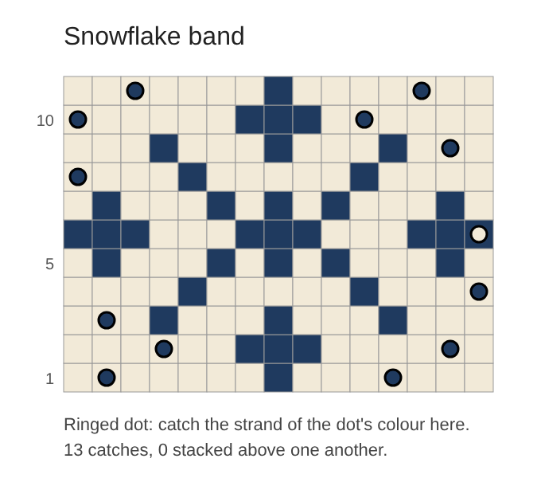

# Floatwise

**Where to catch the long floats in stranded colourwork, so the catches never line up and show through.**

In stranded (Fair Isle) knitting, the colour you're not using is carried along the back as a *float*. Long floats snag fingers and pucker the fabric, so knitters *catch* them by twisting the strand behind a stitch every few stitches.

The usual advice is "catch every five stitches, and don't catch in the same place on the next round". Following both by hand across a whole chart is fiddly. Catches that stack above each other make a faint vertical line of the hidden colour peeking through the front.

Floatwise reads your chart and finds every float longer than your limit. It then plans every catch for the whole chart at once. The plan uses the fewest catches possible, and the catches sit as far from those in the rounds above and below as the pattern allows.

## Features

- **Finds every long float.** It knows that a float in the round runs straight across the end of one repeat into the next, and that a flat piece doesn't wrap.
- **The fewest catches.** Each long float gets exactly as many catches as it needs, and no more. Tests check this against brute force for every length and limit.
- **Plans the whole chart at once.** A dynamic programme over the rounds avoids:
  - catches stacked directly above each other;
  - catches in diagonal neighbours;
  - catches next to each other in one round;
  - catching right beside a colour change;
  - very uneven pieces of a float.

  On small charts it matches trying every combination.
- **Compares with the usual habit** of catching each float evenly, round by round, and tells you how many stacked catches that would have made.
- **Instructions a knitter can follow:** "Round 10: catch navy behind stitches 5 and 15", with stitches counted from the right as charts are read.
- **A drawing:** `--svg` saves the chart in its colours, with a ringed dot wherever a strand is caught.



## Example

```text
$ ./floatwise examples/snowflake-yoke.txt
Floatwise: Snowflake band
Knitted in the round · 15-stitch repeat × 12 · longest float allowed: 5 stitches

  Round Chart              Catches (*)
  11    .......x.......    ··*·········*··
  10    ......xxx......    *·········*····
  9     ...x...x...x...    ·············*·
  8     ....x.....x....    *··············
  7     .x...x.x.x...x.    ···············
  6     xxx...xxx...xxx    ··············*
  5     .x...x.x.x...x.    ···············
  4     ....x.....x....    ··············*
  3     ...x...x...x...    ·*·············
  2     ......xxx......    ···*·········*·
  1     .......x.......    ·*·········*···

Floats over 5 stitches: 9 (longest 14, navy, round 1)
This plan: 13 catches per repeat, 0 stacked pairs, 0 diagonal neighbours, longest float left 5 stitches.
Catching each float evenly instead: 6 stacked pairs, 0 diagonal neighbours.

Round by round (stitches counted from the right of the repeat):
  Round 1: catch navy behind stitches 4 and 14
  Round 2: catch navy behind stitches 2 and 12
  Round 3: catch navy behind stitch 14
  ...
```

Round 6 is worth a look. Its cream float is only three stitches inside the chart, but in the round it runs on past the edge of the repeat into the next one, six stitches in all. Floatwise catches it at the repeat's edge.

## Writing a chart

```text
// Comments are lines that start with two slashes.
title: Snowflake band
// round or flat
knit: round
// how many times round (shown in the report)
repeats: 12
// longest float left uncaught: 2-12 stitches
max-float: 5
// a symbol, a name, and an optional colour for the drawing
colour . cream #f2ead8
colour x navy #1f3a5f

chart:
.......x.......
......xxx......
```

- **Rows:** they are listed as the chart is printed, top first, so the last line is round 1. Every row must be the same width (2–64 stitches).
- **Symbols:** any printable character can be a colour's symbol (up to 8 colours).

## Run and test

Needs Java 21 and `make`.

```bash
make                                         # compiles with -Xlint:all -Werror
./floatwise examples/snowflake-yoke.txt
./floatwise examples/border-flat.txt --max-float 3
./floatwise examples/snowflake-yoke.txt --svg band.svg
make test                                    # no dependencies: a small runner
```

The tests:
- **Rows and stitches:** charts are read bottom first, with stitches counted from the right, and bad charts are refused.
- **Floats:** they wrap in the round but not flat, and a lone stitch floats all the way round.
- **Fewest catches:** the catch count is the minimum, and each float's options are exactly the valid ones (both by brute force).
- **The plan:** it equals the best of every combination on over 100 random charts, never leaves a float over the limit, and is never worse than even spacing.
- **64-stitch repeats:** they wrap correctly.
- **The drawing:** it escapes text.
- **The command line:** broken and hostile input.

## Security

Floatwise reads one chart file and prints a plan, optionally writing a drawing. No software is perfectly secure; this is how the risks are handled.

- **Bounded input:** the chart must be a regular file, not a folder or a symbolic link. It must be at most 64 KB and strictly valid UTF-8, with up to 200 rows, 64 stitches and 8 colours.
- **Strict settings:** every number has a range, and names and titles allow letters, digits and simple punctuation only. Control characters and invisible formatting characters (such as right-to-left overrides) are refused.
- **Errors don't echo the file:** a test checks that a "password" in a bad file never appears in an error.
- **Safe drawing:**
  - all text in the SVG is XML-escaped, and colours must be `#rrggbb`, so nothing in a chart can inject markup or script;
  - the file name must end in `.svg`;
  - it's created new: an existing file, or a link planted in its place, is never overwritten.
- **Bounded work:**
  - a row with too many ways to catch it is trimmed to its 400 best;
  - the search compares 64-bit masks;
  - a maximum-size chart plans in about a second and a half.
- **No risky code:** no dependencies, no reflection, no deserialisation, no network, and no shell. It compiles with every warning treated as an error.

**Limits:**
- Edge floats in flat knitting, where a strand is carried up the side, aren't planned.
- Neither are three-colour rows' bulkiness or tension.
- Catches two rounds apart can still line up faintly; only neighbouring rounds are compared.

## Files

| Path | What it is |
|---|---|
| `src/floatwise/Chart.java` | Reading and validating a chart |
| `src/floatwise/Planner.java` | Floats, catch options, the search, the even-spacing comparison, scoring |
| `src/floatwise/Report.java` | The text plan and the SVG drawing |
| `src/floatwise/Main.java` | Command line: safe reading and writing |
| `tests/floatwise/Tests.java` | Brute force, wrap-round, the 64-bit edge, hostile input |
| `examples/` | A snowflake band (in the round) and a cushion border (flat) |

More detail: [HOW-IT-WORKS.md](HOW-IT-WORKS.md).
