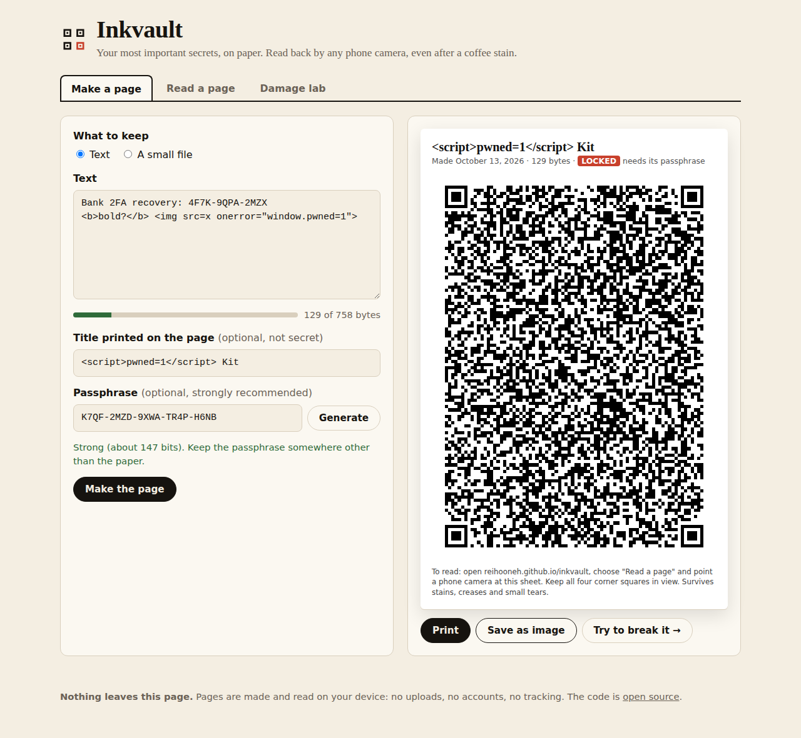
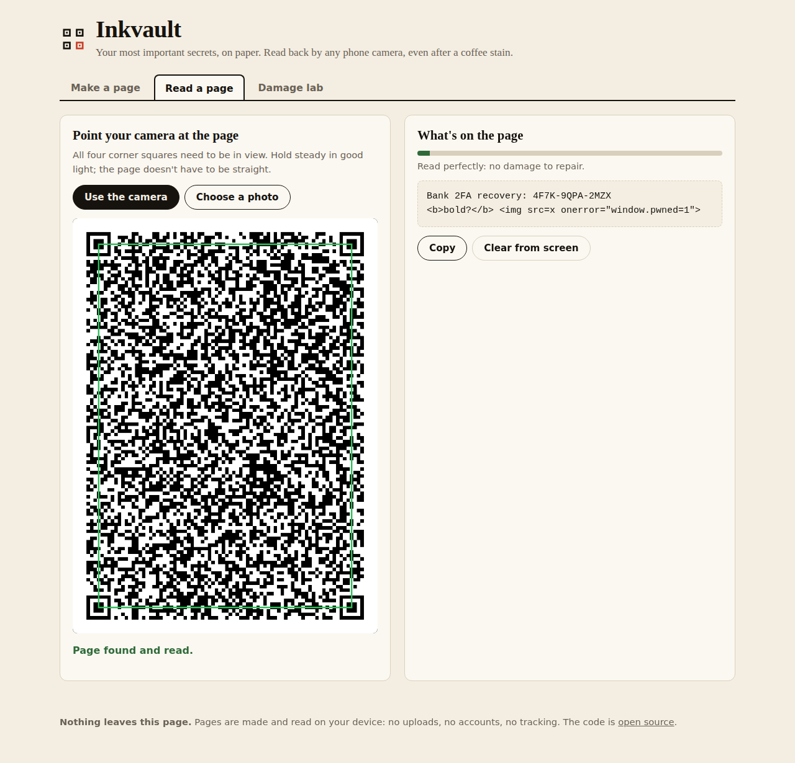
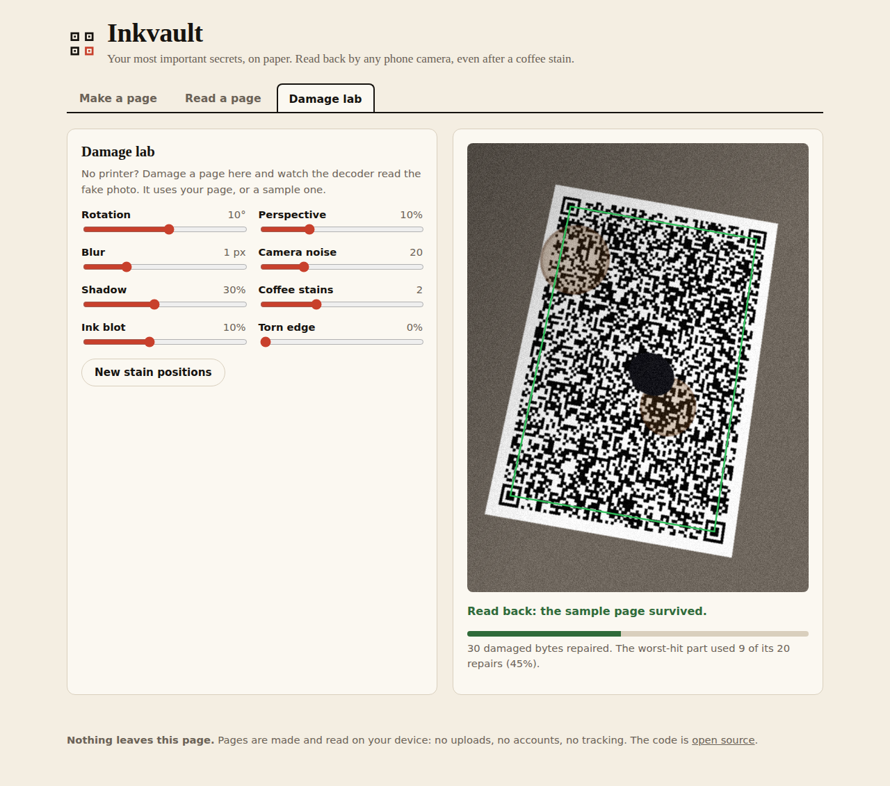
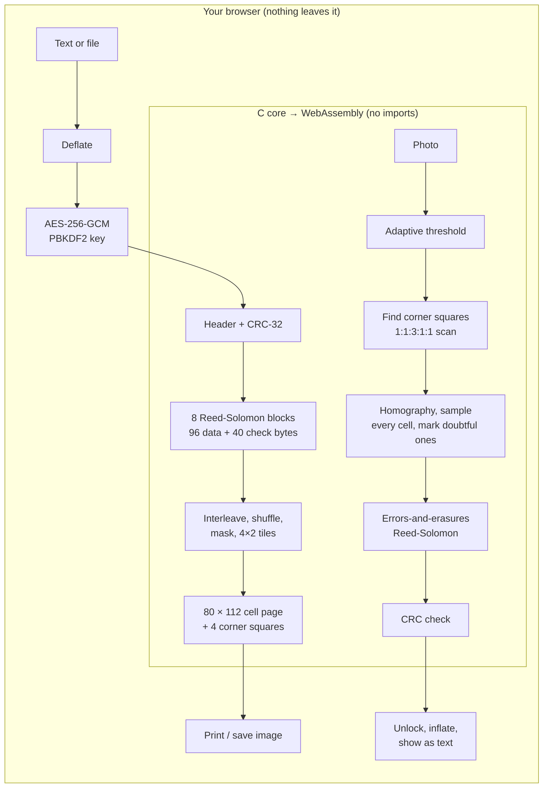

# Inkvault

**Your most important secrets, on paper. Read back by any phone camera, even after a coffee stain.**

[](https://github.com/reihooneh/inkvault/actions/workflows/ci.yml)
[](https://reihooneh.github.io/inkvault/)


[](LICENSE)

**▶ Try it: [reihooneh.github.io/inkvault](https://reihooneh.github.io/inkvault/).** No printer? Open the **Damage lab**, spill coffee on a page, tear it, tilt it, blur it, and watch it still read back.



## Why I built this

Some things should never live only on a computer: two-factor recovery codes, a password manager's emergency kit, a crypto seed phrase, instructions for your family "if something happens". Paper is the standard advice, because it can't be hacked, doesn't need batteries and outlasts every file format. But paper has two problems. Anyone who finds it can read it, and typing 300 characters back in by hand is miserable and error-prone.

QR codes help, but they hold little, and a stain or a fold can kill one. Older paper-backup tools need a desktop program and a flatbed scanner. I wanted something better: a page you print from your browser, lock with a passphrase, and read back years later by pointing **any phone** at it, through a coffee ring, a crease or a torn corner. And nothing should ever leave the device.

## Features

- **Up to 758 bytes per page.** Text is compressed first, so that is often around 1,000 characters of English. A small file works too.
- **Survives damage.** Reed-Solomon error correction is spread across the whole page. Every block can lose 20 of its 136 bytes, and twice that many when the camera can tell which cells it was unsure of (errors-and-erasures decoding).
- **Reads from any angle.** Upside down, sideways, mirrored by a selfie camera, in perspective, in shadow. Tested on simulated stains, ink blots, tears, blur, noise and lens distortion.
- **Locked with a passphrase.** AES-256-GCM with PBKDF2 (600,000 rounds), through the browser's own Web Crypto. A one-click generator makes a strong passphrase you can copy by hand.
- **A health report.** Every read tells you how close the page came to being unreadable, so you know when to print a fresh copy.
- **Damage lab.** Fake a battered photo with sliders and watch the decoder fight back.
- **Private by construction.** One static page, no server, no network after loading, no trackers, a strict Content-Security-Policy, and a WebAssembly core with zero imports.

| Read a page | Damage lab |
|---|---|
|  |  |

## How it works



The full walkthrough, with the maths explained simply, is in **[HOW-IT-WORKS.md](HOW-IT-WORKS.md)**.

## Stack

| Part | What | Why |
|---|---|---|
| Core | C17, freestanding (no libc), compiled to WebAssembly with clang | Fast, small (18 KB), and one codebase tested natively under sanitizers |
| Page | Plain HTML, CSS and JavaScript modules, no framework | Nothing to keep updated, nothing to trust |
| Cryptography | Web Crypto (AES-GCM, PBKDF2) | The browser's audited implementation, not home-made crypto |
| Tests | C test suite, a fuzz driver, `node:test`, Playwright | Every layer, including the real page in a headless browser |
| CI and hosting | GitHub Actions, GitHub Pages | Lint, test, check the WebAssembly, then deploy |

## Run it locally

You need `clang` with the WebAssembly target and `wasm-ld` (Ubuntu: `apt install clang lld`), plus Node 22.

```bash
make wasm                 # builds web/inkvault.wasm
node tests/serve.mjs      # serves web/ at http://127.0.0.1:8080/
```

The camera only works over `https://` or on `localhost`.

## Tests

```bash
npm ci && npx playwright install chromium
make test        # everything below
make test-core   # 13,600+ checks in C, under AddressSanitizer and UBSan
make test-fuzz   # random photos, cell grids and codewords into every decoder
make test-web    # JavaScript unit tests and browser tests at desktop and phone sizes
make lint        # clang-tidy (bugprone, CERT, static analyzer), warnings are errors
make fuzz        # optional: coverage-guided libFuzzer run (clang with compiler-rt)
```

The core tests print pages, "photograph" them in software and read them back:

```
photos
    straight on                    read  repaired   0 bytes, worst block  0 of 20
    upside down                    read  repaired   0 bytes, worst block  0 of 20
    sideways                       read  repaired   0 bytes, worst block  0 of 20
    mirrored (selfie camera)       read  repaired   0 bytes, worst block  0 of 20
    tilted, in perspective         read  repaired   0 bytes, worst block  0 of 20
    blurry and noisy               read  repaired   0 bytes, worst block  0 of 20
    shadow across it               read  repaired   0 bytes, worst block  0 of 20
    coffee stain                   read  repaired   0 bytes, worst block  0 of 20
    torn edge                      read  repaired  35 bytes, worst block  8 of 20
    ink blot                       read  repaired  53 bytes, worst block 11 of 20
    phone lens distortion          read  repaired   0 bytes, worst block  0 of 20
    everything at once             read  repaired   0 bytes, worst block  0 of 20
    low resolution (4 px a cell)   read  repaired   0 bytes, worst block  0 of 20
```

These are simulated photos. The browser tests also read pages back from the real print layout and from saved images. Results from real phones and printers are very welcome as issues.

They also prove the important negative: pages damaged beyond repair are **refused, never misread**. That held across 600 heavily damaged pages and random images.

## Security

- **Encryption:** AES-256-GCM with a PBKDF2-SHA-256 key (600,000 rounds, random salt, fresh IV per page). Tampering is detected.
- **No network:** nothing is uploaded. The CSP is `default-src 'none'`, plus only the page's own scripts, styles and WebAssembly.
- **Sandboxed decoder:** the WebAssembly core has no imports and fixed memory. Every size is checked in both JavaScript and C.
- **Safe output:** restored text is never parsed as HTML. File names are cleaned, and files are only downloaded, never opened.
- **Bounded work:** decompression stops at 64 KB, and the core has fixed memory, no recursion and capped search work.
- **Verified:** sanitizers, a fuzz driver, clang-tidy and browser tests for injected scripts and outside requests.

**Known limits:** a weak passphrase can be guessed offline by whoever holds the paper, and unlocked pages aren't signed. See [SECURITY.md](SECURITY.md) for the full threat model and how to report a problem.

## Roadmap

- **Multi-page backups** with any-k-of-n recovery: lose one sheet out of three and still restore.
- **Shamir secret sharing:** split a secret over pages for different people, so any two can restore it but one alone learns nothing.
- **Installable offline app** (service worker), so recovery works with no internet at all.
- **Alignment marks** across the page, for photos of curled or folded paper.

## Licence

[MIT](LICENSE) © 2026 Reihaneh Rahmati
